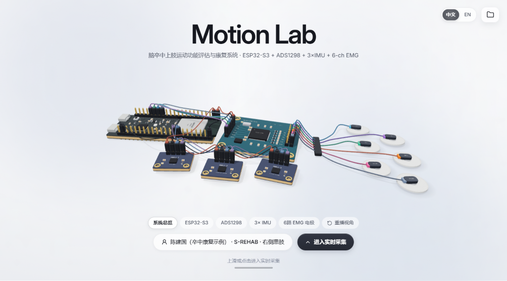
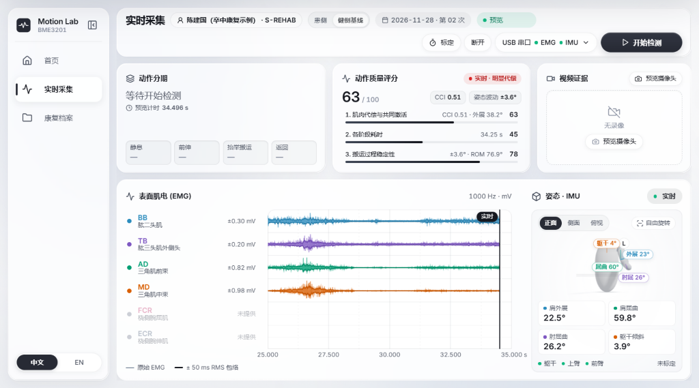
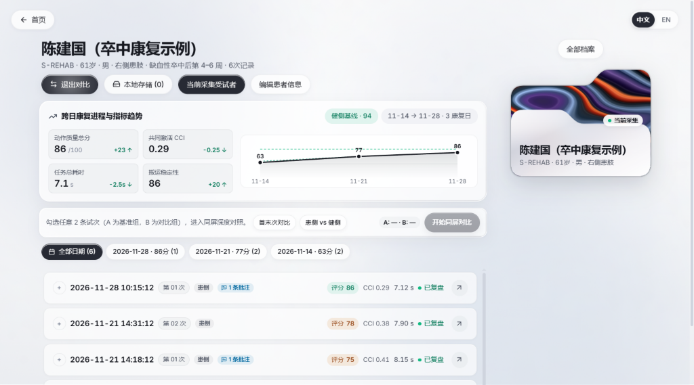
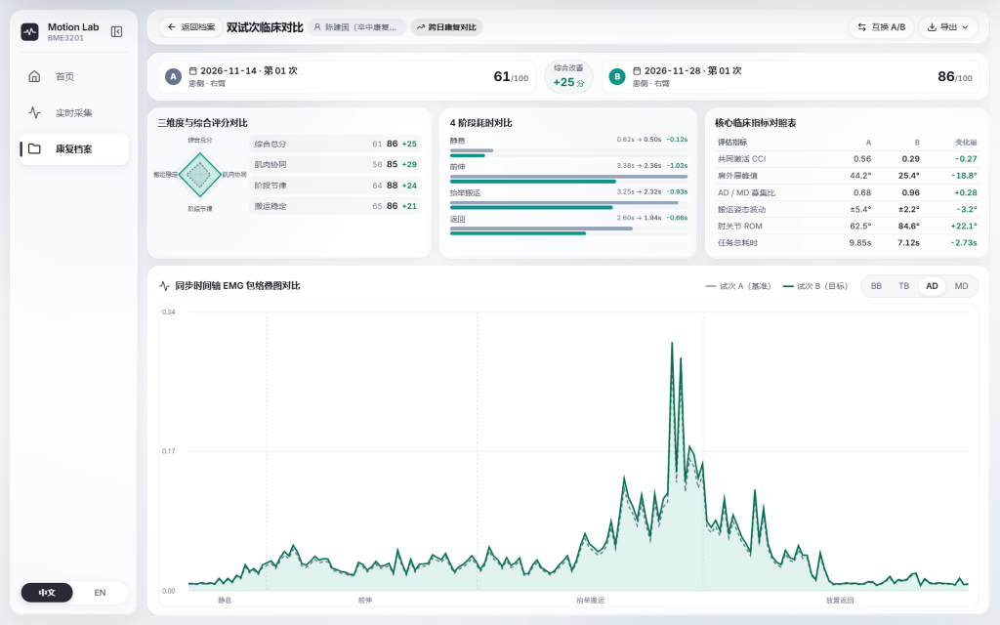
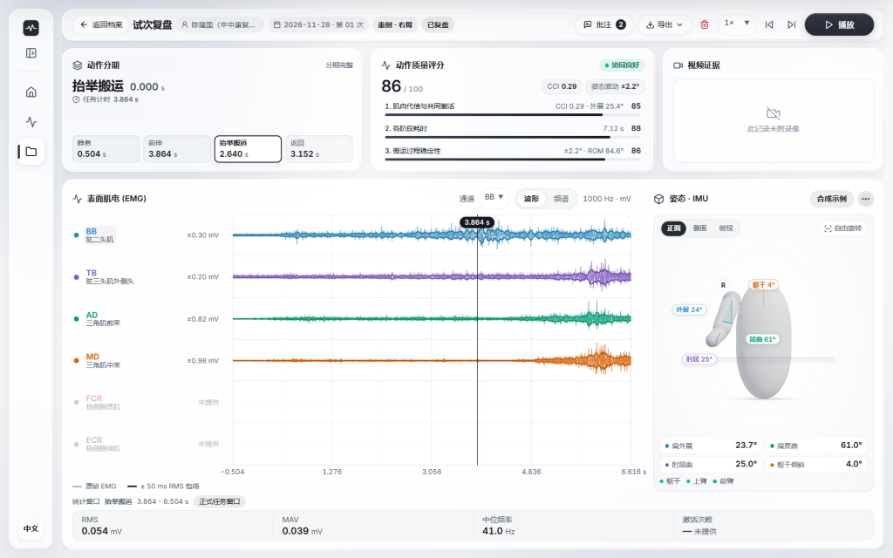
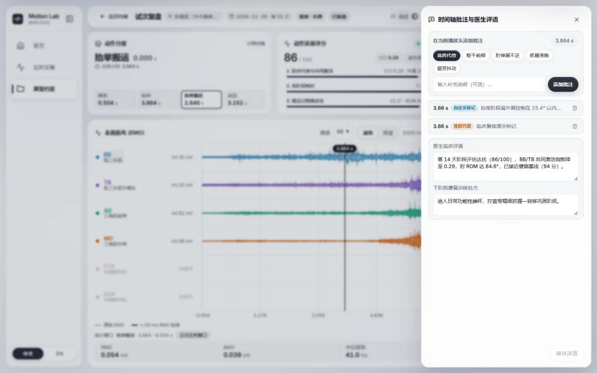

# BME3201 Motion Lab v1.6.0

> 脑卒中上肢表面肌电（sEMG）与三关节 IMU 运动功能评估、临床复盘与双侧对比桌面端（Electron + React 19 + TypeScript + Three.js）


**BME3201 Motion Lab** 是面向脑卒中上肢康复评估与科研分析的前端工作站，采用**液态钛银 · VisionOS 纯白（Liquid Titanium）**视觉语言与桌面端 `100vh` 锁定排版（左右底边 `0.00 px` 精确对齐、零滚动抖动），完整覆盖 **3D 硬件拓扑展示 → 双侧同步采集与实时质量打分 → 跨日康复档案管理 → 双试次同屏对比 → 临床批注处方与 PDF/CSV/视频导出**全闭环。

---

## 核心功能全景与实机截图

### 1. 首页 3D 硬件拓扑建模与 ECG 级幕布交互
- **全场景 Three.js 硬件建模**：按工程比例还原 **ESP32-S3 DevKitC-1**、**ADS1298 八通道生物电采集前端**、**3× IMU 姿态模块（躯干 / 上臂 / 前臂）** 与 **6 路 EMG 按扣导联电极**，支持自由拖拽旋转、双击缩放、模块化视角聚焦胶囊与开场视角重播。
- **双层幕布过渡与全界面光追踪**：沿用 ECG 项目经典的**上滑 / 滚轮切入采集 + 下拉返回首页**阻尼幕布动效，底层与幕布完全隔离（零透字）；全界面按钮与毛玻璃卡片支持平滑鼠标高光追踪，并支持中英文无缝切换。



---

### 2. 实时采集工作台：双侧基线流、摄像头录像与三维度动作质量评估
- **受试者与日期独立编号**：工具栏实时绑定当前患者档案、本地日期与当天独立试次序数（`姓名 · 编号` + `YYYY-MM-DD · 第 XX 次`），避免不同受试者记录混排。
- **患侧 / 健侧基线一键切换**：支持在采集前切换「**患侧** / **健侧基线**」，系统自动映射对侧肢体并实时翻转右侧 **3D 上肢骨骼模型（L / R）**，将肢体角色写入试次元数据。
- **真实摄像头预览与可拖动 WebM 录像**：通过 `navigator.mediaDevices.getUserMedia` + `MediaRecorder` + `ts-ebml` 注入寻址索引，录制结果随试次持久化至本地 IndexedDB。
- **在线三维度动作质量评分**：实时计算并展示综合评分（`/100`）与三维度拆分得分——**1. 肌肉代偿与共同激活（CCI & 肩外展峰值）**、**2. 各阶段耗时**、**3. 搬运过程稳定性（姿态波动与肘 ROM）**。
- **6 路色盲友好 EMG 与 3D 四角度同步可视化**：支持 `BB / TB / AD / MD / FCR / ECR` 波形实时绘制、10% 激活高亮带、丢包斜纹标记及快捷键 `M` 实时打标；右侧 3D `ArmSkeleton` 同屏渲染**肩外展 / 肩屈曲 / 肘屈曲 / 躯干倾斜**四路角度扇形弧与浮动胶囊标签，支持悬停卡片高亮对应关节弧。



---

### 3. 卒中康复档案与跨日康复趋势看板
- **临床患者建档元数据**：支持录入与编辑患者**姓名、病历编号、年龄、性别、患侧上肢（左/右）与临床康复阶段备注**，支持按受试者与日期筛选复盘。
- **跨日康复进程与健侧基线参照**：自动按日期聚合患侧记录并绘制康复折线趋势图，展示**动作质量总分、共同激活 CCI、任务总耗时、搬运稳定性**较初评基线的变化量（Delta）；存在健侧基线试次时自动叠加绿色虚线参考线。
- **对比模式与快捷对照**：提供「**对比模式**」任选两条试次（`A` 基准 / `B` 目标），以及一键触发「**首末次对比**」「**患侧 vs 健侧**」的快捷对比入口。
- **本地存储与录像无损清理**：右上角「**本地存储**」弹窗实时统计总试次数、含录像条数与空间占用（MB / IndexedDB 配额），支持单条导出 `.webm` 或仅清理视频文件（完整保留评分、分期、批注与医生评语）。



---

### 4. 一体化双试次同屏对比工作台
针对临床复盘核心痛点，支持**同侧跨日复盘（Day 1 vs Day 14）**与**双侧对照（患侧 vs 健侧基线）**同屏定量比较：
- **三维度四轴 SVG 雷达与 Delta 对比**：直观呈现总分及三个临床维度改善幅度。
- **4 阶段耗时分组条形对比**：逐项拆解 `静息 / 前伸 / 抬举搬运 / 返回` 耗时变化。
- **6 项核心临床 KPI 对照表**：对比 `CCI / 肩外展峰值 / AD-MD 募集比 / 搬运姿态波动 / 肘关节 ROM / 总耗时` 并标注临床改善方向。
- **同步时间轴 EMG 包络叠图**：支持切换 `BB / TB / AD / MD` 通道，在归一化任务进度轴上叠加绘制 A（灰色虚线）与 B（彩色实线）50 ms RMS 包络及鼠标十字准星差值读数。



---

### 5. 试次复盘、临床批注抽屉与多格式导出中心
- **临床交互净化**：复盘页顶部严格保持单行工具栏，直接展示只读的「**患侧 / 健侧 · 左/右臂**」徽章（防止误改历史试次左右侧）；原本位于底部的工程调试按钮已收纳至姿态区右上角 `···` 折叠菜单，为波形与 3D 骨架释放更大可视空间。
- **滑出式时间轴批注与医生评语抽屉**：点击工具栏「**批注**」呼出右侧毛玻璃抽屉（零挤占主画布）：
  - 在当前播放头选择 5 个卒中常用快捷标签（`耸肩代偿`、`躯干前倾`、`肘伸展不足`、`抓握滑脱`、`疲劳抖动`）+ 自定义文字打标；
  - 波形轴同步渲染交互式批注针（悬停气泡预览、点击跳转对应时刻）；
  - 支持持久化保存「**医生临床评语**」与「**下阶段康复训练处方**」。
- **临床 + 科研一体化导出中心（`导出 ▾`）**：
  - **临床评估报告（PDF）**：A4 纯白医学排版，Electron 桌面端调用原生 `printToPDF` 与系统保存框直接导出 `.pdf`（浏览器预览端自动使用专属 `@media print` 视图），对比工作台同步支持导出双试次对比 PDF 报告；
  - **完整科研数据（CSV）**：UTF-8 with BOM 编码，逐帧输出 `time_ms`、动作分期、6 路 EMG（mV）、4 路 IMU 关节角（°）及时间轴批注，可直接导入 Python / MATLAB / Excel；
  - **结构化摘要（JSON）** 与 **独立视频录像（WebM）**。





---

## 目录结构与技术栈

```text
Code/motion-lab/
├── electron/
│   ├── main.cjs                 # Electron 主进程（自定义协议、媒体权限、原生 printToPDF IPC）
│   ├── preload.cjs              # 安全 contextBridge，暴露最小化 PDF 导出接口
│   └── icon.ico
├── src/
│   ├── App.tsx                  # 五视图幕布路由（首页 / 实时采集 / 康复档案 / 试次复盘 / 双试次对比）
│   ├── model.ts                 # Trial、LimbRole、TrialAnnotation 等核心领域模型
│   ├── assessment.ts            # 三维度动作质量评分引擎
│   ├── store.ts                 # IndexedDB 持久化与录像无损清理辅助
│   ├── BaChart.tsx              # 多通道 sEMG + 波形批注针 + 3D 姿态联动面板
│   ├── BaWaveCanvas.tsx         # 高帧率离屏 Canvas EMG 渲染器
│   ├── export/exportReport.ts   # A4 临床报告 HTML、UTF-8 BOM CSV、JSON 与 WebM 导出引擎
│   ├── components/
│   │   ├── HardwareHero.tsx     # 首页 ESP32-S3 + ADS1298 + 3×IMU + 6-ch EMG 3D 模型
│   │   ├── ArmSkeleton.tsx      # 3D 肢段骨骼与四关节角度实时扇形标注
│   │   └── PosePanel.tsx        # 交互式四角度卡片与 IMU 丢包状态栏
│   ├── pose/                    # 四元数运动学、关节角解析、静息校准与抗丢包插值
│   └── ui/
│       ├── MotionHome.tsx       # 首页幕布视图
│       ├── LiveWorkspace.tsx    # 实时采集与双侧基线切换工作台
│       ├── ArchiveDesk.tsx      # 康复档案、跨日趋势图与对比模式入口
│       ├── CompareWorkspace.tsx # 一体化双试次同屏对比工作台
│       ├── RecordWorkspace.tsx  # 试次复盘工作台
│       ├── ClinicalNotesDrawer.tsx # 临床时间轴批注与评语/处方抽屉
│       ├── StorageManagerModal.tsx # 本地存储空间与录像清理弹窗
│       ├── ExportMenu.tsx       # 多格式导出下拉菜单
│       ├── archive.ts           # 示例卒中患者 S-REHAB 跨日与健侧数据及中英字典
│       └── clinicalMeta.ts      # 肢体侧别映射与标注标签纯函数工具
├── tests/                       # Node 原生单元测试（pose / live-pose / live-ui / v16-clinical）
├── docs/screenshots/            # v1.6.0 实机验证截图
├── IMU-INPUT.md                 # 离线 IMU JSON 数据格式、坐标系约定与调参指南
├── package.json
└── tsconfig.json
```

---

## 本地运行、测试与桌面打包

> 运行环境要求：**Node.js 22+（推荐 24 LTS）** 与 npm。

```bash
# 1. 安装依赖
npm ci

# 2. 启动前端开发服务器（http://127.0.0.1:5173）
npm run dev

# 3. 运行全量自动化单元测试（15/15 通过）
npm test

# 4. TypeScript 类型检查 + Vite 生产构建
npm run build

# 5. 以构建产物启动 Electron 桌面端预览
npm run desktop

# 6. 打包 Windows x64 NSIS 安装程序
npm run package:win
```

### 自动化测试覆盖范围（`npm test`）
- `tests/pose.test.ts`：Z-up 四元数与 Three.js 坐标系一致性、肩/肘/躯干四角度解析、静息校准偏移告警、反极性插值与丢包间隙保护、极值降采样保持。
- `tests/live-pose.test.ts`：受限实时流丢包/恢复、阶段事件校验、JSONL 分包与异常包容错。
- `tests/live-ui.test.ts`：实时预览与校准状态隔离、单流丢失确认、会话草稿流转。
- `tests/v16-clinical.test.ts`：患/健侧对侧镜像映射、UTF-8 BOM 科研 CSV（含 IMU 四角度与批注对齐）、A4 临床报告 HTML 转义安全性、无损清理视频保留指标与评语。

---

## 硬件联调接口与当前阶段说明

当前阶段因硬件固件与在线算法仍在联调中，前端在保持临床评估、复盘、对比、批注与导出全链路真实闭环的前提下，对硬件数据源作如下解耦设计：
1. **硬件连接与演示信号**：实时采集页的 USB/BLE 状态机当前驱动离线基准数据（`ba-st09-01`）与合成上肢姿态流（`mockPose`），便于无硬件条件下全流程演示与医院场景测试；离线 IMU 融合数据的本地 JSON 导入格式详见 [IMU-INPUT.md](IMU-INPUT.md)。
2. **无缝对接规范**：后续联调 ESP32-S3 + ADS1298 实机时，只需将 `DemoPlot` / `LiveWorkspace` 的信号源替换为主进程串口/BLE 帧流并按 `src/assessment.ts` 接口输入实测四元数及 6 路 sEMG 即可，上层的 `Trial`、`TrialAnnotation`、对比工作台与 PDF/CSV 导出无需改动。
